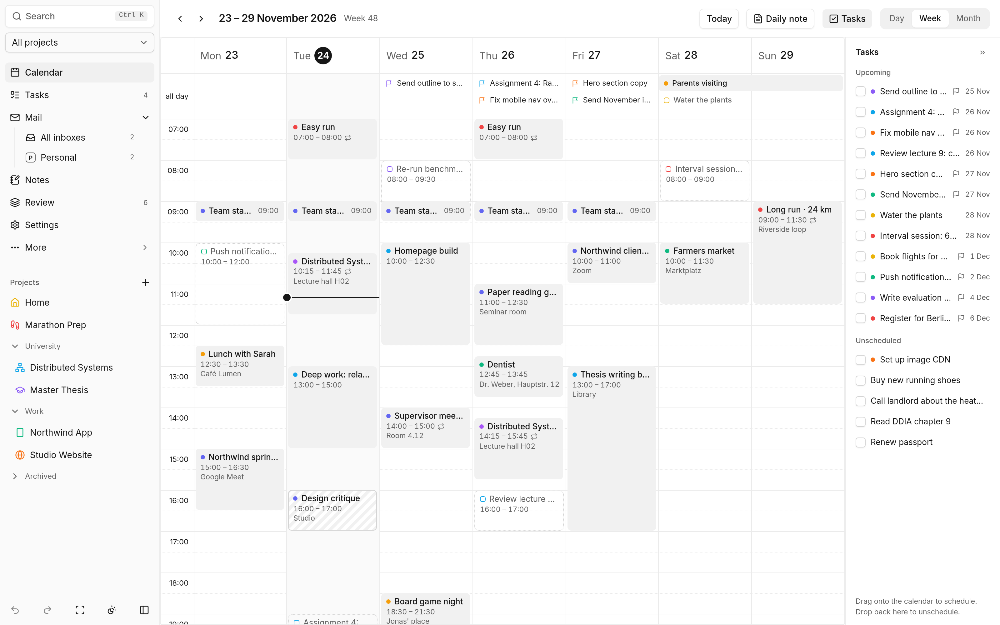
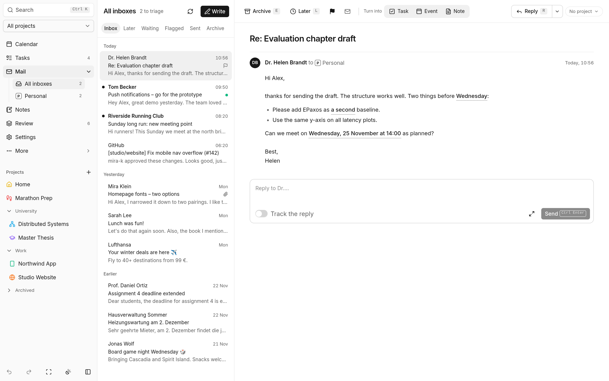
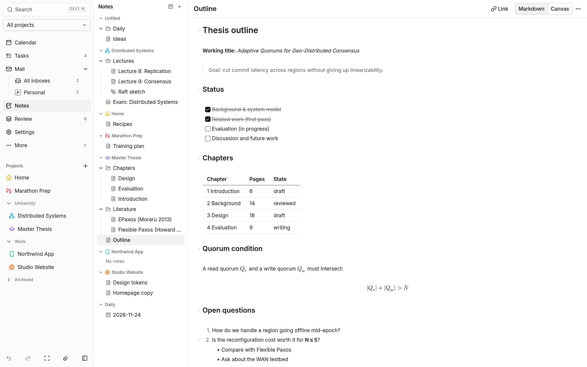
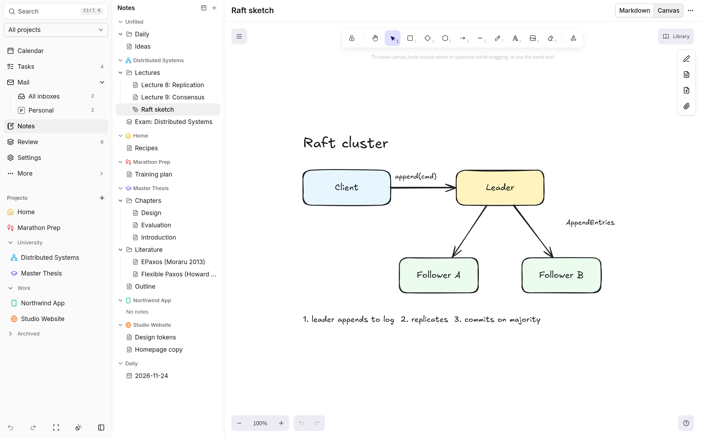
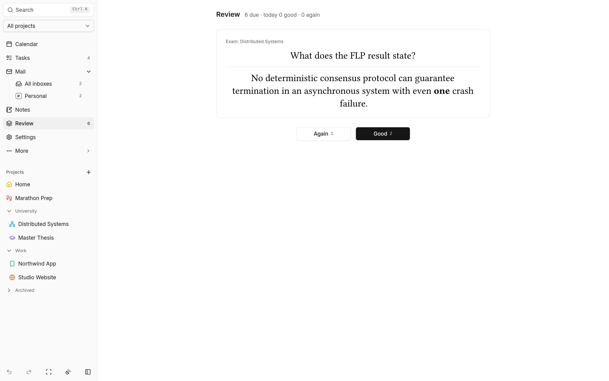
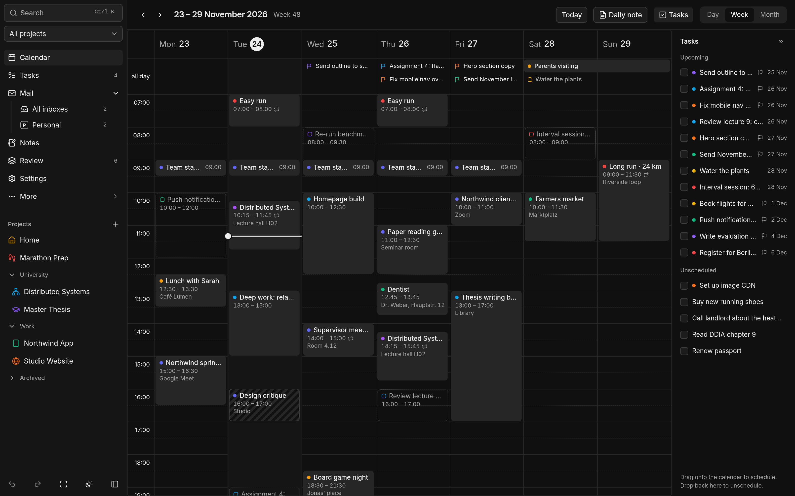

# Commonplace

A personal, single-user planner for the desktop and the iPad, named after the _commonplace book_: the notebook people once kept for everything worth holding on to. It has a calendar, tasks, notes, drawings, flashcards and mail in one app, grouped by projects. Built with SvelteKit, Bun and SQLite, it runs in one container behind a reverse proxy.

> [!WARNING]
> **Built with AI.** Most of the code and documentation in this repository was written by an AI coding agent (Claude Code), directed, reviewed and tested by me. It is a personal project. Expect rough edges and review the code before you trust it with data you care about.

> [!IMPORTANT]
> **No login in the app.** Commonplace has no user accounts or authentication of its own. Run it behind an authenticating reverse proxy (see [Nginx Proxy Manager + Authelia](#nginx-proxy-manager--authelia)) or on a network you trust.

## Gallery

<table>
  <tr>
    <td width="50%"><a href="screenshots/01-calendar-week.png"></a><br><sub><b>Calendar</b>: events, scheduled tasks, deadlines and the tasks pane</sub></td>
    <td width="50%"><a href="screenshots/11-mail.png"></a><br><sub><b>Mail</b>: triage, quick reply, turn a mail into a task, event or note</sub></td>
  </tr>
  <tr>
    <td><a href="screenshots/06-note.png"></a><br><sub><b>Notes</b>: live-preview markdown with tables, math and code</sub></td>
    <td><a href="screenshots/09-canvas.png"></a><br><sub><b>Canvas</b>: Excalidraw drawings with PDF pages and a pen UI for the iPad</sub></td>
  </tr>
  <tr>
    <td><a href="screenshots/15-review.png"></a><br><sub><b>Flashcards</b>: Typst cards, FSRS scheduling</sub></td>
    <td><a href="screenshots/02-calendar-week-dark.png"></a><br><sub><b>Dark mode</b></sub></td>
  </tr>
</table>

More in [`screenshots/`](screenshots/) (task list, month view, project page, search palette, stats…). All data shown is made up.

## Features

- **Calendar**: day / week / endless month view, recurring events with several times each, tentative events, categories. Events and tasks are iCalendar objects and sync both ways with a CalDAV calendar. External ICS / CalDAV calendars are shown read-only.
- **Tasks**: inbox, subtasks, status, priority, deadlines, estimates, recurrence, browser reminders. Drag them onto the calendar to schedule them.
- **Notes**: a tree per project with folders and uploaded files. Markdown notes use our own live-preview editor (CodeMirror 6: tables, math via Typst, code highlighting, images, folding), with daily notes and templates.
- **Canvas**: Excalidraw drawings with images, PDFs as drawable pages and embedded notes, plus a pen toolbar for the iPad.
- **Flashcards**: decks with Typst-rendered cards, reviewed with FSRS scheduling.
- **Mail**: IMAP / SMTP accounts (Gmail, iCloud, any IMAP server).
  - Keyboard triage, "later" times that show in the calendar, writing in markdown, tracked replies.
  - Turn a mail into a task, event or note. Answer invitations from the mail.
  - Optional triage with a local model on your own computer.
- **Projects**: icons, groups, pinned links and sender rules. Focus on one project to filter every view.
- **Everywhere**: search / command palette (`Ctrl K`), global undo / redo, keyboard shortcuts, focus mode, pomodoro timer with stats, light and dark theme.
- **Modules**: leave out parts you don't need, at build time or with a switch in the settings.

**Stack**: SvelteKit 3 · Svelte 5 · Bun (runtime, `bun:sqlite`, tests) · Tailwind 4 + shadcn-svelte · FullCalendar 7 · CodeMirror 6 · Excalidraw · typst.ts · ical.js / tsdav · imapflow / nodemailer.

## Development

With Nix (flakes):

```sh
nix develop          # shell with bun
bun install          # also copies Excalidraw fonts to static/fonts
bun run dev          # http://localhost:5173, data in ./data
```

Without Nix, install [Bun](https://bun.sh) and run the same `bun` commands.

Checks: `bun run check` (svelte-check / types), `bun test` (unit tests in `tests/`), `bun run build`. The CalDAV and IMAP tests run against a real server only when you point them at one with env vars (see "Gotchas" in [`CLAUDE.md`](CLAUDE.md)).

## Deployment

```sh
docker network create proxy   # if Nginx Proxy Manager isn't on a shared network yet
docker compose up -d --build
```

The container listens on port 3000 and is only reachable on the `proxy` network. Data lives in `./data`:

- `commonplace.db`, the database (called `planner.db` before 2026-11-24: renamed on the first start)
- `files/`, uploads
- `mail.db` + `mail/`, the mail cache (can be deleted)
- `typst-fonts/`
- nightly `backups/` (the newest 14 are kept)

| Env                               | Default | Meaning                                                                                                                                             |
| --------------------------------- | ------- | --------------------------------------------------------------------------------------------------------------------------------------------------- |
| `DATA_DIR`                        | `/data` | database, uploads, mail cache, backups                                                                                                              |
| `DB_PATH` / `MAIL_DB_PATH`        | unset   | put `commonplace.db` / `mail.db` somewhere other than `DATA_DIR`                                                                                    |
| `MODULES`                         | `all`   | build arg: which optional modules are built (see [Modules](#modules-building-and-switching-parts-off))                                              |
| `REQUIRE_AUTH_HEADER`             | unset   | `true` → 401 unless the request carries `Remote-User` (set by Authelia)                                                                             |
| `TZ`                              | UTC     | server timezone (backups at 03:00, floating ICS times); set it to the timezone you use Commonplace in: recurring events are written to CalDAV in it |
| `CALDAV_URL`                      | unset   | CalDAV calendar that holds the events and tasks (see below)                                                                                         |
| `CALDAV_USER` / `CALDAV_PASSWORD` | unset   | its login (Basic auth)                                                                                                                              |
| `CALDAV_TASKS_URL`                | unset   | a second calendar for the tasks, if the server keeps them apart                                                                                     |
| `BODY_SIZE_LIMIT`                 | `100M`  | max upload size                                                                                                                                     |
| `CONNECTION_IDLE_TIMEOUT`         | `255`   | seconds before Bun drops a response that hasn't been sent yet (Bun's own default is 10, the Dockerfile sets the maximum so slow syncs get through)  |
| `MAIL_TLS_INSECURE`               | unset   | `true` → accept self-signed certificates of mail servers (own server, tests)                                                                        |
| `PROTOCOL_HEADER` / `HOST_HEADER` | unset   | set to `x-forwarded-proto` / `x-forwarded-host` if needed                                                                                           |

Upgrading an existing instance: read [`MIGRATIONS.md`](MIGRATIONS.md) (newest first) for changes to stored data or the setup.

### Events and tasks on a CalDAV server

Events and tasks are RFC 5545 objects (VEVENT / VTODO; app-only fields are `X-COMMONPLACE-*` properties). With `CALDAV_URL` set, they live in that CalDAV calendar and other apps (phone, desktop) work on the same data. Commonplace keeps a local copy and sends its changes right away. It takes over changes from the server every 5 minutes, when its tab gets the focus, and on "Sync now" in Settings. Without `CALDAV_URL`, the same objects are kept in `planner.db` only.

- `CALDAV_URL` is the URL of **one calendar collection** (not of the server or the account), e.g. `http://radicale:5232/alex/planner/`. It has to exist and accept both VEVENT and VTODO; otherwise give the task list as `CALDAV_TASKS_URL`.
- At the first start with it, everything already in Commonplace is uploaded, and what is in the calendar is taken over.
- Pointing it at another calendar later uploads everything there; nothing is deleted on either side.
- Don't add the same calendar as a read-only "External calendar" as well, or its events show twice.

`docker-compose.yml` has a commented-out [Radicale](https://radicale.org) service as an example.

### Mail

Settings → Mail accounts → Add account (Gmail, iCloud or any IMAP server). Commonplace syncs Inbox, Sent and Archive (Gmail: All Mail) every 5 minutes and when its tab gets the focus. It keeps complete messages of the last 90 days, and the headers and a snippet of older ones. An older message is fetched when you open it. The mail server stays the truth: the copy (`mail.db`, `mail/`) can be deleted while the app is stopped, and the next sync reads it again. Passwords are stored in `commonplace.db` on the server and never sent to the browser.

New inbox mail arrives within seconds: the server keeps one connection per account in IDLE on the inbox (the 5-minute sync stays as a safety net).

- **Triage** on the mail page: `e` archive (with Undo), `l` bring back later (the mail leaves the inbox and sits in the calendar until then), the flag and read buttons (`u`), `j`/`k` to move. Archive, flags and read state go to the mail server; "later" and projects stay in the planner.
- **Writing**: `c` opens the compose panel (markdown body, attachments from the notes or the computer, "Track the reply"). `r` answers in the quick reply under the conversation; its menu has Reply all and Forward.
- **Sending** goes through the account's SMTP server, and the mail is copied to Sent (Gmail does that itself). If sending fails, the message waits and goes out with the next sync. With "Track the reply" the conversation shows under Waiting until someone answers.
- **Turn into** makes a task, an event or a note from a mail. A task gets the deadline found in the mail, and an underlined date in the text offers a task, an event or bringing the mail back then. The items link to the mail, and the mail shows them. An attachment can be saved to the project's notes.
- **Invitations** show as a card with Accept / Maybe / Decline and the hours around them in your calendar. A new invitation is in the calendar as tentative until you answer, and the answer goes to the organizer. Declining removes the event and archives the mail; a cancellation removes the event.
- **Projects**: a mail belongs to a project by hand (the chip in the reading pane), by its account (Settings: "All mail goes to …") or by the project's sender rules (project page: "Mail from"). With a project focused, the list, the counts and search show only its mail.

Account setup:

- **Gmail**: turn on 2-Step Verification, then create an app password (Google Account → Security → App passwords) and enter it as the password. IMAP is on by default for new accounts; otherwise turn it on in Gmail → Settings → Forwarding and POP/IMAP.
- **iCloud**: create an app-specific password at account.apple.com → Sign-In and Security → App-Specific Passwords. The username is your iCloud address.
- **Other**: IMAP server as `host:port` (993 = TLS, 143 = STARTTLS). `MAIL_TLS_INSECURE=true` accepts a self-signed certificate.
- **Proxy**: the browser gets mail changes through a server-sent events stream (`/api/mail/events`). Nginx Proxy Manager passes it through as long as it doesn't buffer it; the app sends `X-Accel-Buffering: no` for that. If the sidebar counts only change after a reload, check the proxy host's custom config for `proxy_buffering`.

### Mail triage (local model)

A decision model sorts and annotates incoming mail. It runs **on your own computer, not on the server**: a browser tab of Commonplace sends each new inbox mail of the last two weeks to the model and saves the answers on the server, so every device sees them. The answers are:

- category, sender, whether you need to act and what to do
- by when, and how important
- phishing and spam

They show as markers in the list (`Reply · Mon`, a shield for possible phishing, a key for login codes), as **All / Needs you / Other** above the inbox, and as a line under the subject. "Details" lists every answer, and you can correct any of them there. Nothing is moved on the mail server.

1. Install [LM Studio](https://lmstudio.ai), download the decision model (`fastino_glide-9b`) and start its local server (Developer → Start server, port 1234). Commonplace calls `POST http://127.0.0.1:1234/v1/decisions`; LM Studio allows browser requests from any site (CORS) by default.
2. In Commonplace: Settings → Mail → Triage → switch on "Triage new mail with a local model" on that computer, then **Test**.
   - Chrome asks once whether the site may reach devices on your local network: allow it.
   - Safari blocks `http://127.0.0.1` from an HTTPS page; use Chrome or Firefox there.
   - Fill in "About you" (study, job) so the model can judge what concerns you.
3. Triage happens only while a Commonplace tab is open on that computer. Mail that came in meanwhile is triaged when you open Commonplace again.

Corrected answers are kept with what the model was told (`triage_labels` in `commonplace.db`). `bun scripts/triage-eval.ts` measures the model on them: accuracy with 95% intervals, calibration and confusions; `--shuffle` checks whether answers change with the order of the options. It uses `TRIAGE_URL` / `TRIAGE_MODEL` if set (default: LM Studio on `127.0.0.1:1234`). The questions are in `src/modules/mail/triage/triage-questions.json`; changing them asks the model about the last two weeks again.

### Modules: building and switching parts off

The optional parts are modules: `calendar`, `tasks`, `mail`, `triage` (needs mail), `notes`, `cards` (flashcards, needs notes), `canvas` (needs notes) and `pomodoro`. Projects, search, settings and stats are always there.

- **Leave modules out of the image** with the `MODULES` build arg in `docker-compose.yml` (`all`, or a comma list such as `calendar,tasks,notes`), then `docker compose up -d --build`.
  - Left-out modules aren't in the bundle at all: a build without mail has no IMAP/SMTP code, one without canvas no Excalidraw.
  - Their pages go to the home page and their API answers 404.
  - The build stops with a message if a module's requirement is missing.
  - Locally: `MODULES=calendar,tasks bun run build` (or `bun run dev`).
- **Switch built modules off** in Settings → General → Features. They disappear from the sidebar, the palette, the keys and the settings, and their syncing stops.

Nothing is deleted either way: data of a left-out or switched-off module stays in the database and comes back with the module.

### Nginx Proxy Manager + Authelia

1. In NPM add a proxy host `commonplace.example.com` → `commonplace`, port `3000`, with SSL.
2. Add the Authelia snippets from the [Authelia NPM guide](https://www.authelia.com/integration/proxies/nginx-proxy-manager/) and put this in the host's **Advanced** tab:

```nginx
client_max_body_size 100m;
include /snippets/authelia-location.conf;

location / {
    include /snippets/proxy.conf;
    include /snippets/authelia-authrequest.conf;   # sets Remote-User for the app
    proxy_pass $forward_scheme://$server:$port;
}
```

3. In Authelia's `access_control`, add a rule for `commonplace.example.com` (`one_factor` or `two_factor`).

When the Authelia session expires, the app keeps unsaved note drafts in the browser and asks you to reload.

## Documentation

- [`CLAUDE.md`](CLAUDE.md): architecture, conventions and gotchas, written as instructions for the AI agent. It is also the most complete technical overview of the code.
- [`MIGRATIONS.md`](MIGRATIONS.md): upgrade notes for changes to stored data or the deployment.
- [`docs/`](docs/): the feature plans and design notes the app was built from (`plan*.md`, `email.md` for mail, `app.md` for a UI inventory, `notes-files.md` and `native_swift.md` for designs not built yet).

## License

[GNU Affero General Public License v3.0](LICENSE). If you run a modified version as a service for others, you have to offer them its source.
